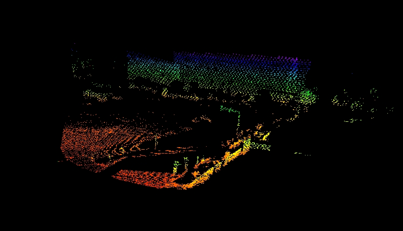
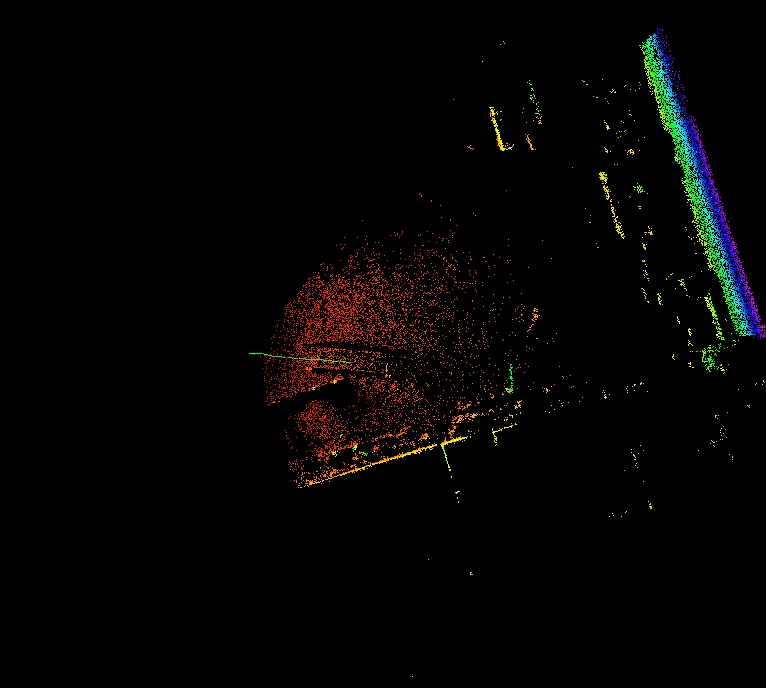
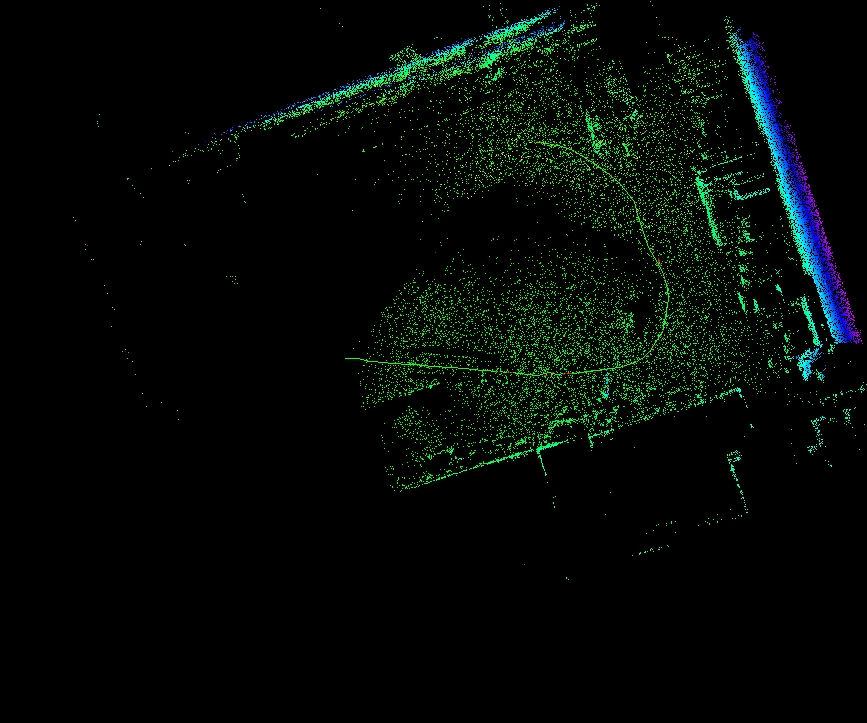
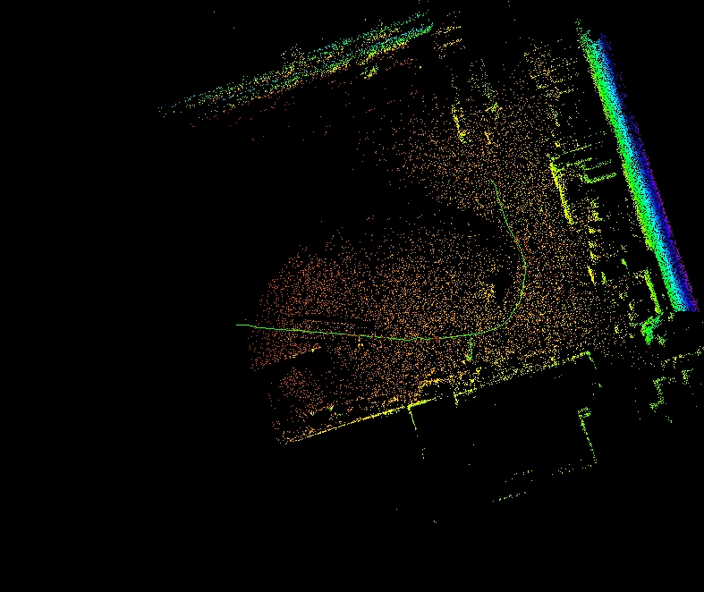
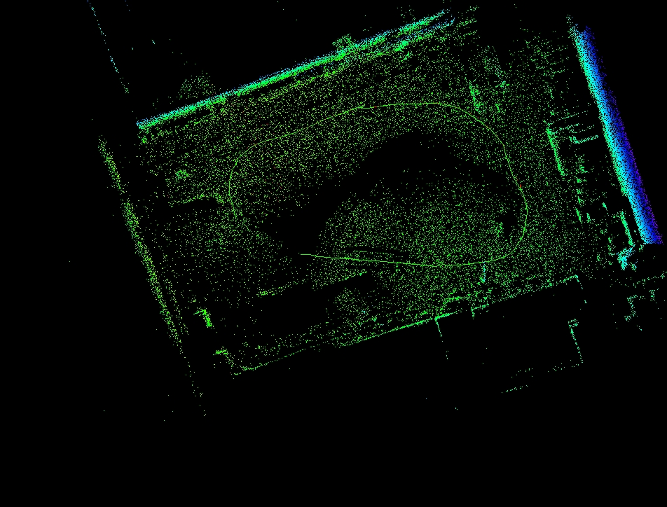
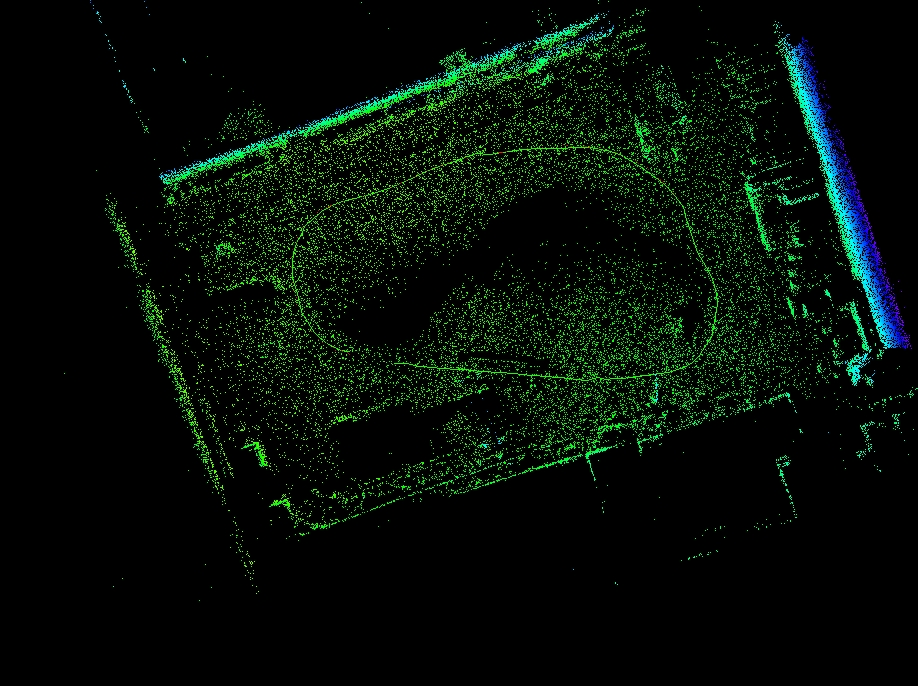
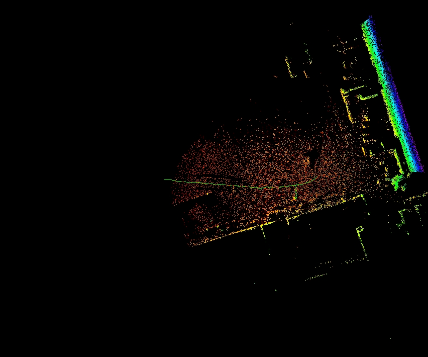
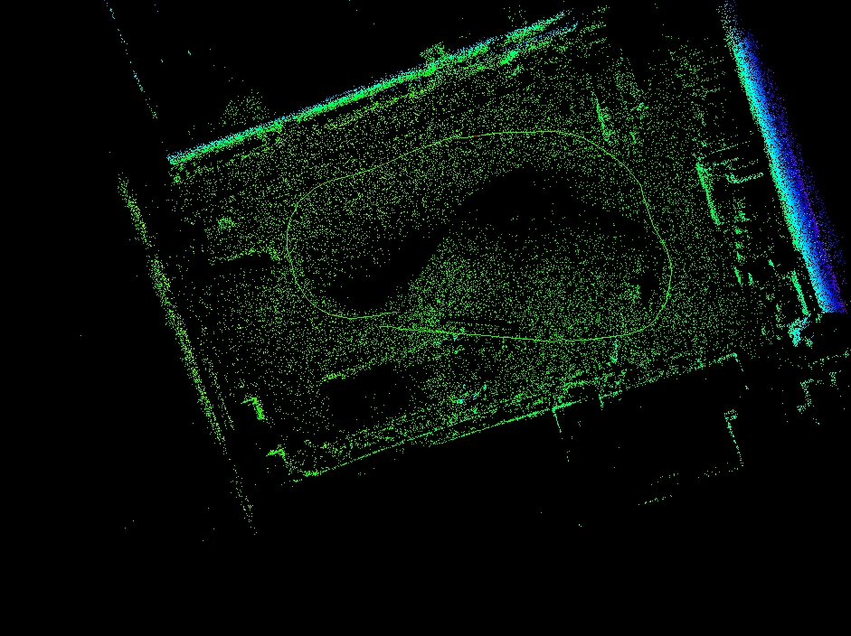

# fast_lio_ex

根据FAST_LIO：
https://github.com/hku-mars/FAST_LIO/
的ROS2分支改造

1、适配ROS2 Foxy

laserMapping.cpp：

void map_save_callback(std_srvs::srv::Trigger::Request::ConstSharedPtr req, std_srvs::srv::Trigger::Response::SharedPtr res)

改为

void map_save_callback(std_srvs::srv::Trigger::Request::SharedPtr req, std_srvs::srv::Trigger::Response::SharedPtr res)

2、加入对速腾RSM1雷达的支持

3、加入来自惯导的gnss、imu数据的支持

4、启动

ros2 run fast_lio gps_to_imu.py --ros-args -p gps_type:=common_msgs/msg/GpsInfo

ros2 launch fast_lio mapping.launch.py

ros2 bag play <ros bag数据包名>

